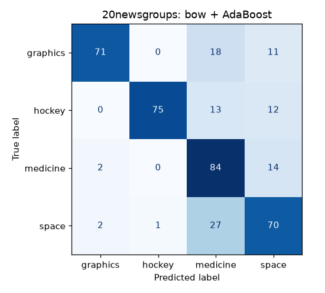
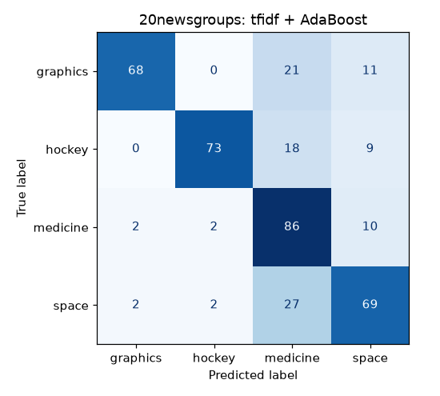
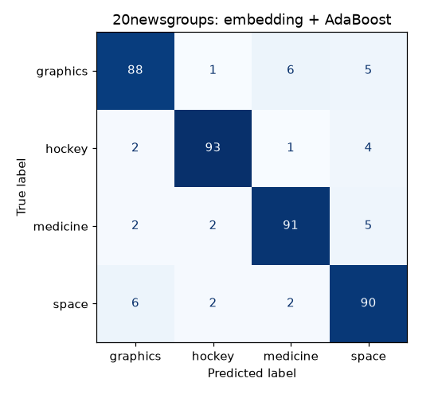
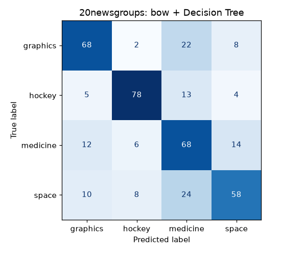
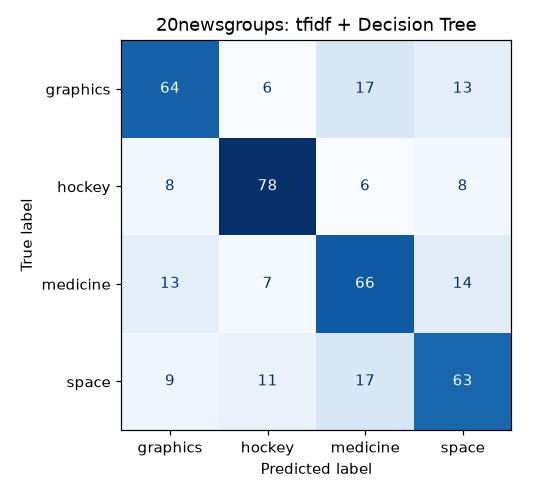

# Wyniki: 20newsgroups

Liczba przykladow: 2000 | trening: 1600 | test: 400 (stratyfikacja, random_state=42)

Metody: AdaBoost (`adaboost`), Decision Tree (`tree`)

## Parametry reprezentacji

```
Bag of Words (CountVectorizer) - rzadki wektor liczby wystapien termow
  ngram_range = (1, 2)  # (1, 2) = pojedyncze slowa + pary slow (np. 'raport kwartalny'); bigramy lapia krotkie frazy, ktore niosa wiecej znaczenia niz slowa osobno
  min_df = 2  # term musi wystapic w >= 2 dokumentach; odrzuca literowki i unikaty, ktore i tak nie pomoga uogolnic
  max_df = 0.9  # odrzuca termy obecne w > 90% dokumentow (dzialaja jak stopwords)
  max_features = 20000  # limit slownika do 20 000 najczestszych termow (pamiec i szybkosc)
  lowercase = True  # male litery (tekst i tak jest juz po clean_text)
  binary = False  # False = liczba wystapien termu, a nie tylko 0/1
TF-IDF (TfidfVectorizer) - rzadki wektor wag tf * idf
  ngram_range = (1, 2)  # (1, 2) = pojedyncze slowa + pary slow (np. 'raport kwartalny'); bigramy lapia krotkie frazy, ktore niosa wiecej znaczenia niz slowa osobno
  min_df = 2  # term musi wystapic w >= 2 dokumentach; odrzuca literowki i unikaty, ktore i tak nie pomoga uogolnic
  max_df = 0.9  # odrzuca termy obecne w > 90% dokumentow (dzialaja jak stopwords)
  max_features = 20000  # limit slownika do 20 000 najczestszych termow (pamiec i szybkosc)
  lowercase = True  # male litery (tekst i tak jest juz po clean_text)
  use_idf = True  # waga IDF: rzadkie w korpusie slowa sa wazniejsze
  smooth_idf = True  # +1 w liczniku i mianowniku IDF, brak dzielenia przez zero
  sublinear_tf = True  # tf -> 1 + log(tf); slowo powtorzone 10x nie jest 10x wazniejsze
  norm = l2  # normalizacja L2 wektora dokumentu - dlugie teksty nie dominuja
Embedding (sentence-transformers) - gesty wektor znaczenia zdania
  model_name = sentence-transformers/paraphrase-multilingual-MiniLM-L12-v2  # wielojezyczny model sentence-transformers (PL + EN), wektor 384 liczb; zdania o podobnym znaczeniu maja bliskie wektory nawet bez wspolnych slow
  normalize_embeddings = True  # wektory o dlugosci 1 (iloczyn skalarny = podobienstwo kosinusowe)
  batch_size = 64  # ile zdan liczy sie naraz (kompromis pamiec/szybkosc)
```

### AdaBoost

* `estimator`: DecisionTree(max_depth=2) - slaby klasyfikator; plytkie drzewo (2 pytania) zamiast 'pienka', bo przy 3-4 klasach pienek rozroznia naraz tylko jedna klase
* `n_estimators`: 300 kolejnych drzew; kazde skupia sie na przykladach, na ktorych poprzednie sie mylily
* `learning_rate`: 0.5 - zmniejsza wage kazdego drzewa; wolniejsza nauka, ale mniejsze przeuczenie
* `random_state`: 42 - powtarzalnosc wynikow

### Decision Tree

* `criterion`: gini - miara nieczystosci wezla przy wyborze podzialu
* `max_depth`: None - drzewo rosnie, az liscie beda czyste (ryzyko przeuczenia)
* `min_samples_leaf`: 2 - lisc musi miec >= 2 przyklady; lagodzi przeuczenie na pojedynczych, rzadkich slowach
* `random_state`: 42 - powtarzalnosc (losowa kolejnosc cech przy remisach)

## bow + AdaBoost

```
               pred_graphics  pred_hockey  pred_medicine  pred_space
true_graphics             71            0             18          11
true_hockey                0           75             13          12
true_medicine              2            0             84          14
true_space                 2            1             27          70

ACC = 0.750 | ERR = 0.250 | F1 (macro) = 0.759 | n = 400

Metryki per klasa (one-vs-rest):
klasa     TP  FP  FN   TN   ACC   ERR  Prec   Rec    F1
graphics  71   4  29  296 0.917 0.083 0.947 0.710 0.811
hockey    75   1  25  299 0.935 0.065 0.987 0.750 0.852
medicine  84  58  16  242 0.815 0.185 0.592 0.840 0.694
space     70  37  30  263 0.833 0.168 0.654 0.700 0.676

macro   : Precision = 0.795 | Recall = 0.750 | F1 = 0.759
weighted: Precision = 0.795 | Recall = 0.750 | F1 = 0.759
```



## tfidf + AdaBoost

```
               pred_graphics  pred_hockey  pred_medicine  pred_space
true_graphics             68            0             21          11
true_hockey                0           73             18           9
true_medicine              2            2             86          10
true_space                 2            2             27          69

ACC = 0.740 | ERR = 0.260 | F1 (macro) = 0.748 | n = 400

Metryki per klasa (one-vs-rest):
klasa     TP  FP  FN   TN   ACC   ERR  Prec   Rec    F1
graphics  68   4  32  296 0.910 0.090 0.944 0.680 0.791
hockey    73   4  27  296 0.922 0.077 0.948 0.730 0.825
medicine  86  66  14  234 0.800 0.200 0.566 0.860 0.683
space     69  30  31  270 0.848 0.152 0.697 0.690 0.693

macro   : Precision = 0.789 | Recall = 0.740 | F1 = 0.748
weighted: Precision = 0.789 | Recall = 0.740 | F1 = 0.748
```



## embedding + AdaBoost

```
               pred_graphics  pred_hockey  pred_medicine  pred_space
true_graphics             88            1              6           5
true_hockey                2           93              1           4
true_medicine              2            2             91           5
true_space                 6            2              2          90

ACC = 0.905 | ERR = 0.095 | F1 (macro) = 0.905 | n = 400

Metryki per klasa (one-vs-rest):
klasa     TP  FP  FN   TN   ACC   ERR  Prec   Rec    F1
graphics  88  10  12  290 0.945 0.055 0.898 0.880 0.889
hockey    93   5   7  295 0.970 0.030 0.949 0.930 0.939
medicine  91   9   9  291 0.955 0.045 0.910 0.910 0.910
space     90  14  10  286 0.940 0.060 0.865 0.900 0.882

macro   : Precision = 0.906 | Recall = 0.905 | F1 = 0.905
weighted: Precision = 0.906 | Recall = 0.905 | F1 = 0.905
```



## bow + Decision Tree

```
               pred_graphics  pred_hockey  pred_medicine  pred_space
true_graphics             68            2             22           8
true_hockey                5           78             13           4
true_medicine             12            6             68          14
true_space                10            8             24          58

ACC = 0.680 | ERR = 0.320 | F1 (macro) = 0.683 | n = 400

Metryki per klasa (one-vs-rest):
klasa     TP  FP  FN   TN   ACC   ERR  Prec   Rec    F1
graphics  68  27  32  273 0.853 0.147 0.716 0.680 0.697
hockey    78  16  22  284 0.905 0.095 0.830 0.780 0.804
medicine  68  59  32  241 0.772 0.228 0.535 0.680 0.599
space     58  26  42  274 0.830 0.170 0.690 0.580 0.630

macro   : Precision = 0.693 | Recall = 0.680 | F1 = 0.683
weighted: Precision = 0.693 | Recall = 0.680 | F1 = 0.683
```



## tfidf + Decision Tree

```
               pred_graphics  pred_hockey  pred_medicine  pred_space
true_graphics             64            6             17          13
true_hockey                8           78              6           8
true_medicine             13            7             66          14
true_space                 9           11             17          63

ACC = 0.677 | ERR = 0.323 | F1 (macro) = 0.677 | n = 400

Metryki per klasa (one-vs-rest):
klasa     TP  FP  FN   TN   ACC   ERR  Prec   Rec    F1
graphics  64  30  36  270 0.835 0.165 0.681 0.640 0.660
hockey    78  24  22  276 0.885 0.115 0.765 0.780 0.772
medicine  66  40  34  260 0.815 0.185 0.623 0.660 0.641
space     63  35  37  265 0.820 0.180 0.643 0.630 0.636

macro   : Precision = 0.678 | Recall = 0.677 | F1 = 0.677
weighted: Precision = 0.678 | Recall = 0.677 | F1 = 0.677
```



## embedding + Decision Tree

```
               pred_graphics  pred_hockey  pred_medicine  pred_space
true_graphics             68            8             10          14
true_hockey                5           83              4           8
true_medicine             11           10             71           8
true_space                16            8              9          67

ACC = 0.723 | ERR = 0.277 | F1 (macro) = 0.722 | n = 400

Metryki per klasa (one-vs-rest):
klasa     TP  FP  FN   TN   ACC   ERR  Prec   Rec    F1
graphics  68  32  32  268 0.840 0.160 0.680 0.680 0.680
hockey    83  26  17  274 0.892 0.107 0.761 0.830 0.794
medicine  71  23  29  277 0.870 0.130 0.755 0.710 0.732
space     67  30  33  270 0.843 0.158 0.691 0.670 0.680

macro   : Precision = 0.722 | Recall = 0.722 | F1 = 0.722
weighted: Precision = 0.722 | Recall = 0.723 | F1 = 0.722
```


## Podsumowanie

| repr | metoda | ACC | ERR | Precision (macro) | Recall (macro) | F1 (macro) | F1 (weighted) | wlasne zdania | czas treningu [s] |
|---|---|---|---|---|---|---|---|---|---|
| embedding | adaboost | 0.905 | 0.095 | 0.906 | 0.905 | 0.905 | 0.905 | 0.875 | 42.8 |
| bow | adaboost | 0.750 | 0.250 | 0.795 | 0.750 | 0.759 | 0.759 | 0.625 | 5.8 |
| tfidf | adaboost | 0.740 | 0.260 | 0.789 | 0.740 | 0.748 | 0.748 | 0.625 | 8.0 |
| embedding | tree | 0.723 | 0.278 | 0.722 | 0.723 | 0.722 | 0.722 | 0.5 | 0.3 |
| bow | tree | 0.680 | 0.320 | 0.693 | 0.680 | 0.683 | 0.683 | 0.375 | 0.7 |
| tfidf | tree | 0.677 | 0.323 | 0.678 | 0.677 | 0.677 | 0.677 | 0.375 | 0.7 |

## Walidacja na wlasnych zdaniach

| zdanie | oczekiwana | bow+adaboost | tfidf+adaboost | embedding+adaboost | bow+tree | tfidf+tree | embedding+tree |
|---|---|---|---|---|---|---|---|
| How do I render a 3D mesh with smooth shading in OpenGL? | graphics | ❌ space 0.25 | ❌ space 0.25 | ❌ space 0.26 | ❌ medicine 0.67 | ✅ graphics 1.00 | ❌ space 1.00 |
| Which JPEG compression format gives the best image quality? | graphics | ✅ graphics 0.25 | ✅ graphics 0.25 | ✅ graphics 0.27 | ✅ graphics 1.00 | ✅ graphics 0.50 | ❌ medicine 0.67 |
| The goalie made 40 saves and the Penguins won in overtime | hockey | ❌ space 0.25 | ❌ space 0.25 | ✅ hockey 0.27 | ❌ medicine 0.67 | ❌ medicine 0.67 | ❌ graphics 1.00 |
| Who will win the Stanley Cup playoffs this year? | hockey | ✅ hockey 0.25 | ✅ hockey 0.26 | ✅ hockey 0.27 | ❌ space 1.00 | ❌ medicine 1.00 | ❌ space 1.00 |
| My doctor prescribed antibiotics for a chronic sinus infection | medicine | ✅ medicine 0.25 | ✅ medicine 0.25 | ✅ medicine 0.27 | ❌ hockey 1.00 | ❌ hockey 1.00 | ✅ medicine 1.00 |
| Is there any evidence that this diet lowers cholesterol? | medicine | ❌ graphics 0.25 | ❌ graphics 0.25 | ✅ medicine 0.26 | ❌ graphics 0.50 | ❌ graphics 1.00 | ✅ medicine 1.00 |
| The shuttle launch was delayed because of a booster problem | space | ✅ space 0.25 | ✅ space 0.25 | ✅ space 0.27 | ✅ space 1.00 | ❌ medicine 1.00 | ✅ space 1.00 |
| NASA plans to send a probe to orbit Jupiter | space | ✅ space 0.26 | ✅ space 0.26 | ✅ space 0.27 | ✅ space 0.50 | ✅ space 1.00 | ✅ space 1.00 |
