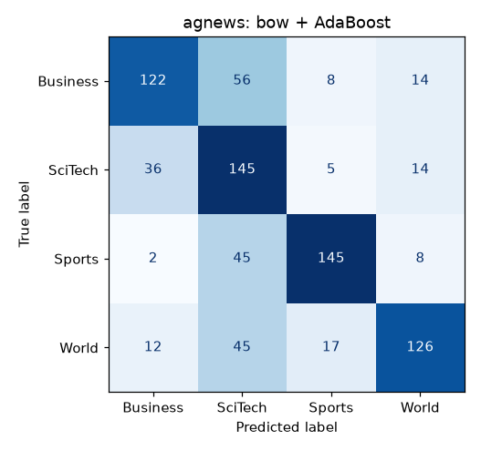
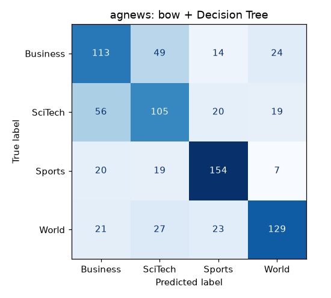
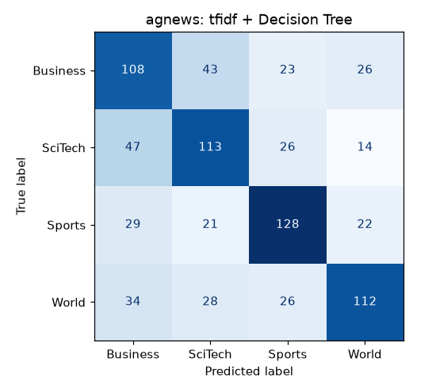
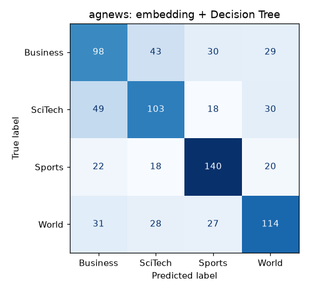

# Wyniki: agnews

Liczba przykladow: 4000 | trening: 3200 | test: 800 (stratyfikacja, random_state=42)

Metody: AdaBoost (`adaboost`), Decision Tree (`tree`)

## Parametry reprezentacji

```
Bag of Words (CountVectorizer) - rzadki wektor liczby wystapien termow
  ngram_range = (1, 2)  # (1, 2) = pojedyncze slowa + pary slow (np. 'raport kwartalny'); bigramy lapia krotkie frazy, ktore niosa wiecej znaczenia niz slowa osobno
  min_df = 2  # term musi wystapic w >= 2 dokumentach; odrzuca literowki i unikaty, ktore i tak nie pomoga uogolnic
  max_df = 0.9  # odrzuca termy obecne w > 90% dokumentow (dzialaja jak stopwords)
  max_features = 20000  # limit slownika do 20 000 najczestszych termow (pamiec i szybkosc)
  lowercase = True  # male litery (tekst i tak jest juz po clean_text)
  binary = False  # False = liczba wystapien termu, a nie tylko 0/1
TF-IDF (TfidfVectorizer) - rzadki wektor wag tf * idf
  ngram_range = (1, 2)  # (1, 2) = pojedyncze slowa + pary slow (np. 'raport kwartalny'); bigramy lapia krotkie frazy, ktore niosa wiecej znaczenia niz slowa osobno
  min_df = 2  # term musi wystapic w >= 2 dokumentach; odrzuca literowki i unikaty, ktore i tak nie pomoga uogolnic
  max_df = 0.9  # odrzuca termy obecne w > 90% dokumentow (dzialaja jak stopwords)
  max_features = 20000  # limit slownika do 20 000 najczestszych termow (pamiec i szybkosc)
  lowercase = True  # male litery (tekst i tak jest juz po clean_text)
  use_idf = True  # waga IDF: rzadkie w korpusie slowa sa wazniejsze
  smooth_idf = True  # +1 w liczniku i mianowniku IDF, brak dzielenia przez zero
  sublinear_tf = True  # tf -> 1 + log(tf); slowo powtorzone 10x nie jest 10x wazniejsze
  norm = l2  # normalizacja L2 wektora dokumentu - dlugie teksty nie dominuja
Embedding (sentence-transformers) - gesty wektor znaczenia zdania
  model_name = sentence-transformers/paraphrase-multilingual-MiniLM-L12-v2  # wielojezyczny model sentence-transformers (PL + EN), wektor 384 liczb; zdania o podobnym znaczeniu maja bliskie wektory nawet bez wspolnych slow
  normalize_embeddings = True  # wektory o dlugosci 1 (iloczyn skalarny = podobienstwo kosinusowe)
  batch_size = 64  # ile zdan liczy sie naraz (kompromis pamiec/szybkosc)
```

### AdaBoost

* `estimator`: DecisionTree(max_depth=2) - slaby klasyfikator; plytkie drzewo (2 pytania) zamiast 'pienka', bo przy 3-4 klasach pienek rozroznia naraz tylko jedna klase
* `n_estimators`: 300 kolejnych drzew; kazde skupia sie na przykladach, na ktorych poprzednie sie mylily
* `learning_rate`: 0.5 - zmniejsza wage kazdego drzewa; wolniejsza nauka, ale mniejsze przeuczenie
* `random_state`: 42 - powtarzalnosc wynikow

### Decision Tree

* `criterion`: gini - miara nieczystosci wezla przy wyborze podzialu
* `max_depth`: None - drzewo rosnie, az liscie beda czyste (ryzyko przeuczenia)
* `min_samples_leaf`: 2 - lisc musi miec >= 2 przyklady; lagodzi przeuczenie na pojedynczych, rzadkich slowach
* `random_state`: 42 - powtarzalnosc (losowa kolejnosc cech przy remisach)

## bow + AdaBoost

```
               pred_Business  pred_SciTech  pred_Sports  pred_World
true_Business            122            56            8          14
true_SciTech              36           145            5          14
true_Sports                2            45          145           8
true_World                12            45           17         126

ACC = 0.672 | ERR = 0.328 | F1 (macro) = 0.679 | n = 800

Metryki per klasa (one-vs-rest):
klasa     TP  FP  FN   TN   ACC   ERR  Prec   Rec    F1
Business 122  50  78  550 0.840 0.160 0.709 0.610 0.656
SciTech  145 146  55  454 0.749 0.251 0.498 0.725 0.591
Sports   145  30  55  570 0.894 0.106 0.829 0.725 0.773
World    126  36  74  564 0.863 0.138 0.778 0.630 0.696

macro   : Precision = 0.703 | Recall = 0.672 | F1 = 0.679
weighted: Precision = 0.703 | Recall = 0.672 | F1 = 0.679
```



## tfidf + AdaBoost

```
               pred_Business  pred_SciTech  pred_Sports  pred_World
true_Business            126            50           12          12
true_SciTech              37           141            8          14
true_Sports                3            38          150           9
true_World                13            41           18         128

ACC = 0.681 | ERR = 0.319 | F1 (macro) = 0.686 | n = 800

Metryki per klasa (one-vs-rest):
klasa     TP  FP  FN   TN   ACC   ERR  Prec   Rec    F1
Business 126  53  74  547 0.841 0.159 0.704 0.630 0.665
SciTech  141 129  59  471 0.765 0.235 0.522 0.705 0.600
Sports   150  38  50  562 0.890 0.110 0.798 0.750 0.773
World    128  35  72  565 0.866 0.134 0.785 0.640 0.705

macro   : Precision = 0.702 | Recall = 0.681 | F1 = 0.686
weighted: Precision = 0.702 | Recall = 0.681 | F1 = 0.686
```


## embedding + AdaBoost

```
               pred_Business  pred_SciTech  pred_Sports  pred_World
true_Business            151            30            4          15
true_SciTech              34           157            1           8
true_Sports                7             2          170          21
true_World                17            16            9         158

ACC = 0.795 | ERR = 0.205 | F1 (macro) = 0.796 | n = 800

Metryki per klasa (one-vs-rest):
klasa     TP  FP  FN   TN   ACC   ERR  Prec   Rec    F1
Business 151  58  49  542 0.866 0.134 0.722 0.755 0.738
SciTech  157  48  43  552 0.886 0.114 0.766 0.785 0.775
Sports   170  14  30  586 0.945 0.055 0.924 0.850 0.885
World    158  44  42  556 0.892 0.107 0.782 0.790 0.786

macro   : Precision = 0.799 | Recall = 0.795 | F1 = 0.796
weighted: Precision = 0.799 | Recall = 0.795 | F1 = 0.796
```


## bow + Decision Tree

```
               pred_Business  pred_SciTech  pred_Sports  pred_World
true_Business            113            49           14          24
true_SciTech              56           105           20          19
true_Sports               20            19          154           7
true_World                21            27           23         129

ACC = 0.626 | ERR = 0.374 | F1 (macro) = 0.627 | n = 800

Metryki per klasa (one-vs-rest):
klasa     TP  FP  FN   TN   ACC   ERR  Prec   Rec    F1
Business 113  97  87  503 0.770 0.230 0.538 0.565 0.551
SciTech  105  95  95  505 0.762 0.237 0.525 0.525 0.525
Sports   154  57  46  543 0.871 0.129 0.730 0.770 0.749
World    129  50  71  550 0.849 0.151 0.721 0.645 0.681

macro   : Precision = 0.628 | Recall = 0.626 | F1 = 0.627
weighted: Precision = 0.628 | Recall = 0.626 | F1 = 0.627
```



## tfidf + Decision Tree

```
               pred_Business  pred_SciTech  pred_Sports  pred_World
true_Business            108            43           23          26
true_SciTech              47           113           26          14
true_Sports               29            21          128          22
true_World                34            28           26         112

ACC = 0.576 | ERR = 0.424 | F1 (macro) = 0.577 | n = 800

Metryki per klasa (one-vs-rest):
klasa     TP  FP  FN   TN   ACC   ERR  Prec   Rec    F1
Business 108 110  92  490 0.748 0.253 0.495 0.540 0.517
SciTech  113  92  87  508 0.776 0.224 0.551 0.565 0.558
Sports   128  75  72  525 0.816 0.184 0.631 0.640 0.635
World    112  62  88  538 0.812 0.188 0.644 0.560 0.599

macro   : Precision = 0.580 | Recall = 0.576 | F1 = 0.577
weighted: Precision = 0.580 | Recall = 0.576 | F1 = 0.577
```



## embedding + Decision Tree

```
               pred_Business  pred_SciTech  pred_Sports  pred_World
true_Business             98            43           30          29
true_SciTech              49           103           18          30
true_Sports               22            18          140          20
true_World                31            28           27         114

ACC = 0.569 | ERR = 0.431 | F1 (macro) = 0.568 | n = 800

Metryki per klasa (one-vs-rest):
klasa     TP  FP  FN   TN   ACC   ERR  Prec   Rec    F1
Business  98 102 102  498 0.745 0.255 0.490 0.490 0.490
SciTech  103  89  97  511 0.767 0.233 0.536 0.515 0.526
Sports   140  75  60  525 0.831 0.169 0.651 0.700 0.675
World    114  79  86  521 0.794 0.206 0.591 0.570 0.580

macro   : Precision = 0.567 | Recall = 0.569 | F1 = 0.568
weighted: Precision = 0.567 | Recall = 0.569 | F1 = 0.568
```



## Podsumowanie

| repr | metoda | ACC | ERR | Precision (macro) | Recall (macro) | F1 (macro) | F1 (weighted) | wlasne zdania | czas treningu [s] |
|---|---|---|---|---|---|---|---|---|---|
| embedding | adaboost | 0.795 | 0.205 | 0.799 | 0.795 | 0.796 | 0.796 | 0.9167 | 67.8 |
| tfidf | adaboost | 0.681 | 0.319 | 0.702 | 0.681 | 0.686 | 0.686 | 0.75 | 6.0 |
| bow | adaboost | 0.672 | 0.328 | 0.704 | 0.672 | 0.679 | 0.679 | 0.6667 | 4.2 |
| bow | tree | 0.626 | 0.374 | 0.628 | 0.626 | 0.627 | 0.627 | 0.4167 | 0.7 |
| tfidf | tree | 0.576 | 0.424 | 0.580 | 0.576 | 0.577 | 0.577 | 0.5833 | 0.6 |
| embedding | tree | 0.569 | 0.431 | 0.567 | 0.569 | 0.568 | 0.568 | 0.5833 | 0.7 |

## Walidacja na wlasnych zdaniach

| zdanie | oczekiwana | bow+adaboost | tfidf+adaboost | embedding+adaboost | bow+tree | tfidf+tree | embedding+tree |
|---|---|---|---|---|---|---|---|
| The striker scored twice as the home team won the cup final | Sports | ✅ Sports 0.26 | ✅ Sports 0.26 | ✅ Sports 0.27 | ✅ Sports 1.00 | ✅ Sports 1.00 | ✅ Sports 1.00 |
| Central bank raises interest rates to fight inflation | Business | ❌ SciTech 0.25 | ❌ SciTech 0.25 | ✅ Business 0.26 | ❌ SciTech 0.33 | ✅ Business 0.50 | ❌ World 1.00 |
| Researchers unveil a new chip that speeds up AI training | SciTech | ✅ SciTech 0.25 | ✅ SciTech 0.25 | ✅ SciTech 0.27 | ✅ SciTech 0.33 | ✅ SciTech 1.00 | ✅ SciTech 1.00 |
| Peace talks resume between the two countries after border clashes | World | ❌ SciTech 0.25 | ❌ SciTech 0.25 | ✅ World 0.26 | ✅ World 1.00 | ❌ Sports 1.00 | ❌ Sports 1.00 |
| Shares of the carmaker fell after weak quarterly earnings | Business | ❌ SciTech 0.25 | ✅ Business 0.25 | ✅ Business 0.26 | ❌ World 1.00 | ❌ SciTech 1.00 | ❌ World 0.67 |
| NASA probe sends back first images from the far side of the moon | SciTech | ✅ SciTech 0.25 | ✅ SciTech 0.25 | ✅ SciTech 0.26 | ❌ Business 1.00 | ✅ SciTech 1.00 | ✅ SciTech 1.00 |
| Tennis champion withdraws from the open with a knee injury | Sports | ✅ Sports 0.25 | ✅ Sports 0.25 | ✅ Sports 0.26 | ❌ Business 1.00 | ✅ Sports 1.00 | ✅ Sports 1.00 |
| Prime minister resigns amid corruption scandal | World | ✅ World 0.26 | ✅ World 0.26 | ✅ World 0.26 | ✅ World 1.00 | ✅ World 1.00 | ✅ World 1.00 |
| Tech giant buys gaming startup for two billion dollars | Business | ✅ Business 0.25 | ✅ Business 0.25 | ❌ SciTech 0.26 | ✅ Business 1.00 | ✅ Business 1.00 | ❌ World 1.00 |
| Apple releases a security update for the iPhone | SciTech | ✅ SciTech 0.25 | ✅ SciTech 0.25 | ✅ SciTech 0.26 | ❌ Business 1.00 | ❌ Sports 1.00 | ❌ World 1.00 |
| Olympic committee bans athletes over doping | Sports | ✅ Sports 0.25 | ✅ Sports 0.25 | ✅ Sports 0.26 | ❌ SciTech 0.33 | ❌ SciTech 1.00 | ✅ Sports 1.00 |
| Floods displace thousands across southern Asia | World | ❌ SciTech 0.25 | ❌ SciTech 0.25 | ✅ World 0.26 | ❌ SciTech 0.33 | ❌ SciTech 1.00 | ✅ World 1.00 |
