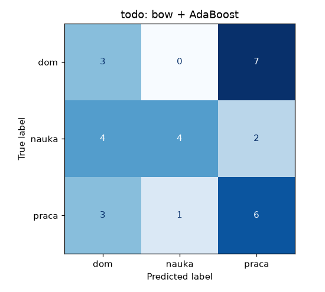
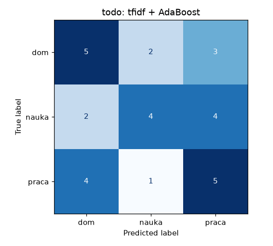
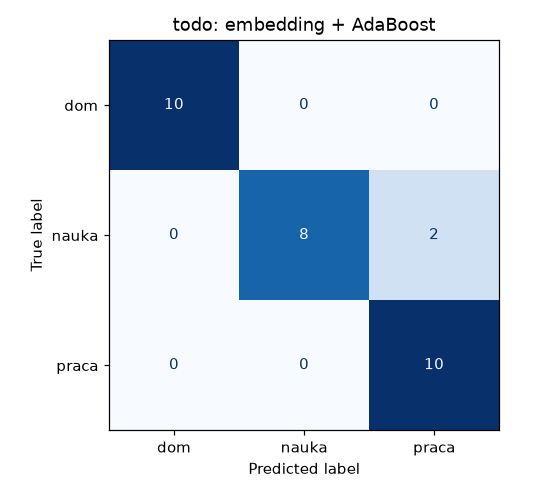
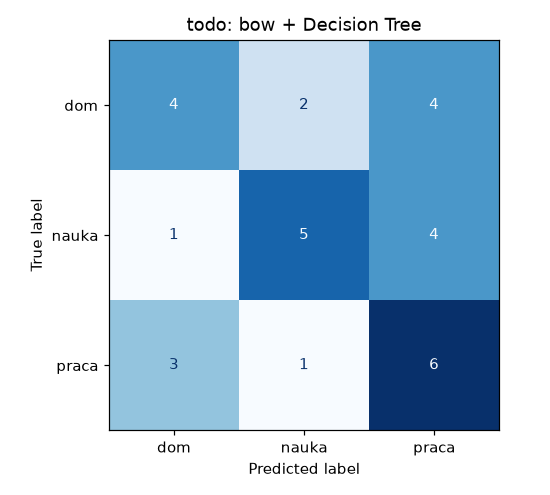
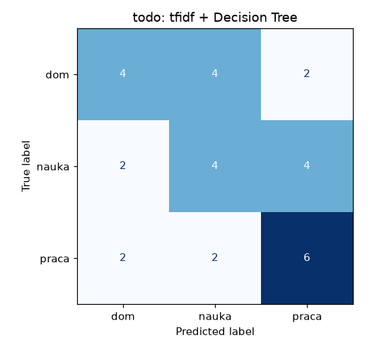
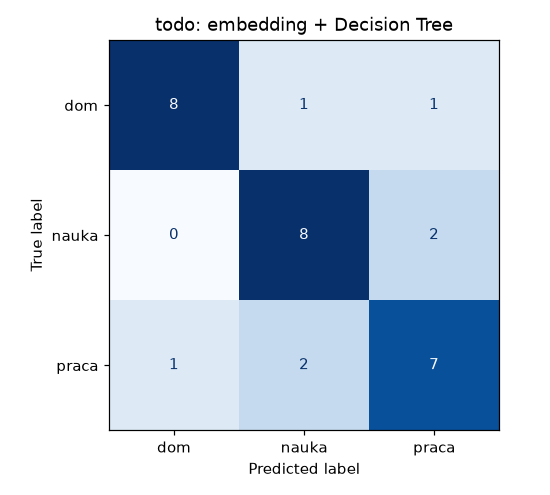

# Wyniki: todo

Liczba przykladow: 150 | trening: 120 | test: 30 (stratyfikacja, random_state=42)

Metody: AdaBoost (`adaboost`), Decision Tree (`tree`)

## Parametry reprezentacji

```
Bag of Words (CountVectorizer) - rzadki wektor liczby wystapien termow
  ngram_range = (1, 2)  # (1, 2) = pojedyncze slowa + pary slow (np. 'raport kwartalny'); bigramy lapia krotkie frazy, ktore niosa wiecej znaczenia niz slowa osobno
  min_df = 2  # term musi wystapic w >= 2 dokumentach; odrzuca literowki i unikaty, ktore i tak nie pomoga uogolnic
  max_df = 0.9  # odrzuca termy obecne w > 90% dokumentow (dzialaja jak stopwords)
  max_features = 20000  # limit slownika do 20 000 najczestszych termow (pamiec i szybkosc)
  lowercase = True  # male litery (tekst i tak jest juz po clean_text)
  binary = False  # False = liczba wystapien termu, a nie tylko 0/1
TF-IDF (TfidfVectorizer) - rzadki wektor wag tf * idf
  ngram_range = (1, 2)  # (1, 2) = pojedyncze slowa + pary slow (np. 'raport kwartalny'); bigramy lapia krotkie frazy, ktore niosa wiecej znaczenia niz slowa osobno
  min_df = 2  # term musi wystapic w >= 2 dokumentach; odrzuca literowki i unikaty, ktore i tak nie pomoga uogolnic
  max_df = 0.9  # odrzuca termy obecne w > 90% dokumentow (dzialaja jak stopwords)
  max_features = 20000  # limit slownika do 20 000 najczestszych termow (pamiec i szybkosc)
  lowercase = True  # male litery (tekst i tak jest juz po clean_text)
  use_idf = True  # waga IDF: rzadkie w korpusie slowa sa wazniejsze
  smooth_idf = True  # +1 w liczniku i mianowniku IDF, brak dzielenia przez zero
  sublinear_tf = True  # tf -> 1 + log(tf); slowo powtorzone 10x nie jest 10x wazniejsze
  norm = l2  # normalizacja L2 wektora dokumentu - dlugie teksty nie dominuja
Embedding (sentence-transformers) - gesty wektor znaczenia zdania
  model_name = sentence-transformers/paraphrase-multilingual-MiniLM-L12-v2  # wielojezyczny model sentence-transformers (PL + EN), wektor 384 liczb; zdania o podobnym znaczeniu maja bliskie wektory nawet bez wspolnych slow
  normalize_embeddings = True  # wektory o dlugosci 1 (iloczyn skalarny = podobienstwo kosinusowe)
  batch_size = 64  # ile zdan liczy sie naraz (kompromis pamiec/szybkosc)
```

### AdaBoost

* `estimator`: DecisionTree(max_depth=2) - slaby klasyfikator; plytkie drzewo (2 pytania) zamiast 'pienka', bo przy 3-4 klasach pienek rozroznia naraz tylko jedna klase
* `n_estimators`: 300 kolejnych drzew; kazde skupia sie na przykladach, na ktorych poprzednie sie mylily
* `learning_rate`: 0.5 - zmniejsza wage kazdego drzewa; wolniejsza nauka, ale mniejsze przeuczenie
* `random_state`: 42 - powtarzalnosc wynikow

### Decision Tree

* `criterion`: gini - miara nieczystosci wezla przy wyborze podzialu
* `max_depth`: None - drzewo rosnie, az liscie beda czyste (ryzyko przeuczenia)
* `min_samples_leaf`: 2 - lisc musi miec >= 2 przyklady; lagodzi przeuczenie na pojedynczych, rzadkich slowach
* `random_state`: 42 - powtarzalnosc (losowa kolejnosc cech przy remisach)

## bow + AdaBoost

```
            pred_dom  pred_nauka  pred_praca
true_dom           3           0           7
true_nauka         4           4           2
true_praca         3           1           6

ACC = 0.433 | ERR = 0.567 | F1 (macro) = 0.438 | n = 30

Metryki per klasa (one-vs-rest):
klasa  TP  FP  FN   TN   ACC   ERR  Prec   Rec    F1
dom     3   7   7   13 0.533 0.467 0.300 0.300 0.300
nauka   4   1   6   19 0.767 0.233 0.800 0.400 0.533
praca   6   9   4   11 0.567 0.433 0.400 0.600 0.480

macro   : Precision = 0.500 | Recall = 0.433 | F1 = 0.438
weighted: Precision = 0.500 | Recall = 0.433 | F1 = 0.438
```



## tfidf + AdaBoost

```
            pred_dom  pred_nauka  pred_praca
true_dom           5           2           3
true_nauka         2           4           4
true_praca         4           1           5

ACC = 0.467 | ERR = 0.533 | F1 (macro) = 0.467 | n = 30

Metryki per klasa (one-vs-rest):
klasa  TP  FP  FN   TN   ACC   ERR  Prec   Rec    F1
dom     5   6   5   14 0.633 0.367 0.455 0.500 0.476
nauka   4   3   6   17 0.700 0.300 0.571 0.400 0.471
praca   5   7   5   13 0.600 0.400 0.417 0.500 0.455

macro   : Precision = 0.481 | Recall = 0.467 | F1 = 0.467
weighted: Precision = 0.481 | Recall = 0.467 | F1 = 0.467
```



## embedding + AdaBoost

```
            pred_dom  pred_nauka  pred_praca
true_dom          10           0           0
true_nauka         0           8           2
true_praca         0           0          10

ACC = 0.933 | ERR = 0.067 | F1 (macro) = 0.933 | n = 30

Metryki per klasa (one-vs-rest):
klasa  TP  FP  FN   TN   ACC   ERR  Prec   Rec    F1
dom    10   0   0   20 1.000 0.000 1.000 1.000 1.000
nauka   8   0   2   20 0.933 0.067 1.000 0.800 0.889
praca  10   2   0   18 0.933 0.067 0.833 1.000 0.909

macro   : Precision = 0.944 | Recall = 0.933 | F1 = 0.933
weighted: Precision = 0.944 | Recall = 0.933 | F1 = 0.933
```



## bow + Decision Tree

```
            pred_dom  pred_nauka  pred_praca
true_dom           4           2           4
true_nauka         1           5           4
true_praca         3           1           6

ACC = 0.500 | ERR = 0.500 | F1 (macro) = 0.500 | n = 30

Metryki per klasa (one-vs-rest):
klasa  TP  FP  FN   TN   ACC   ERR  Prec   Rec    F1
dom     4   4   6   16 0.667 0.333 0.500 0.400 0.444
nauka   5   3   5   17 0.733 0.267 0.625 0.500 0.556
praca   6   8   4   12 0.600 0.400 0.429 0.600 0.500

macro   : Precision = 0.518 | Recall = 0.500 | F1 = 0.500
weighted: Precision = 0.518 | Recall = 0.500 | F1 = 0.500
```



## tfidf + Decision Tree

```
            pred_dom  pred_nauka  pred_praca
true_dom           4           4           2
true_nauka         2           4           4
true_praca         2           2           6

ACC = 0.467 | ERR = 0.533 | F1 (macro) = 0.463 | n = 30

Metryki per klasa (one-vs-rest):
klasa  TP  FP  FN   TN   ACC   ERR  Prec   Rec    F1
dom     4   4   6   16 0.667 0.333 0.500 0.400 0.444
nauka   4   6   6   14 0.600 0.400 0.400 0.400 0.400
praca   6   6   4   14 0.667 0.333 0.500 0.600 0.545

macro   : Precision = 0.467 | Recall = 0.467 | F1 = 0.463
weighted: Precision = 0.467 | Recall = 0.467 | F1 = 0.463
```



## embedding + Decision Tree

```
            pred_dom  pred_nauka  pred_praca
true_dom           8           1           1
true_nauka         0           8           2
true_praca         1           2           7

ACC = 0.767 | ERR = 0.233 | F1 (macro) = 0.768 | n = 30

Metryki per klasa (one-vs-rest):
klasa  TP  FP  FN   TN   ACC   ERR  Prec   Rec    F1
dom     8   1   2   19 0.900 0.100 0.889 0.800 0.842
nauka   8   3   2   17 0.833 0.167 0.727 0.800 0.762
praca   7   3   3   17 0.800 0.200 0.700 0.700 0.700

macro   : Precision = 0.772 | Recall = 0.767 | F1 = 0.768
weighted: Precision = 0.772 | Recall = 0.767 | F1 = 0.768
```



## Podsumowanie

| repr | metoda | ACC | ERR | Precision (macro) | Recall (macro) | F1 (macro) | F1 (weighted) | wlasne zdania | czas treningu [s] |
|---|---|---|---|---|---|---|---|---|---|
| embedding | adaboost | 0.933 | 0.067 | 0.944 | 0.933 | 0.933 | 0.933 | 0.8333 | 7.3 |
| embedding | tree | 0.767 | 0.233 | 0.772 | 0.767 | 0.768 | 0.768 | 0.6667 | 0.0 |
| bow | tree | 0.500 | 0.500 | 0.518 | 0.500 | 0.500 | 0.500 | 0.5833 | 0.0 |
| tfidf | adaboost | 0.467 | 0.533 | 0.481 | 0.467 | 0.467 | 0.467 | 0.6667 | 0.3 |
| tfidf | tree | 0.467 | 0.533 | 0.467 | 0.467 | 0.463 | 0.463 | 0.6667 | 0.0 |
| bow | adaboost | 0.433 | 0.567 | 0.500 | 0.433 | 0.438 | 0.438 | 0.75 | 0.3 |

## Walidacja na wlasnych zdaniach

| zdanie | oczekiwana | bow+adaboost | tfidf+adaboost | embedding+adaboost | bow+tree | tfidf+tree | embedding+tree |
|---|---|---|---|---|---|---|---|
| Napisać raport z laboratorium | nauka | ✅ nauka 0.35 | ✅ nauka 0.34 | ✅ nauka 0.39 | ✅ nauka 0.50 | ✅ nauka 0.50 | ✅ nauka 1.00 |
| Wysłać prezentację klientowi przed piątkiem | praca | ✅ praca 0.34 | ✅ praca 0.34 | ✅ praca 0.42 | ❌ dom 0.50 | ✅ praca 0.67 | ✅ praca 1.00 |
| Przygotować slajdy na obronę inżynierki | nauka | ❌ dom 0.34 | ❌ praca 0.35 | ❌ praca 0.37 | ❌ praca 1.00 | ❌ praca 1.00 | ✅ nauka 1.00 |
| Kupić pomidory i ser na pizzę | dom | ✅ dom 0.36 | ✅ dom 0.36 | ✅ dom 0.43 | ✅ dom 1.00 | ✅ dom 1.00 | ✅ dom 1.00 |
| Odkurzyć samochód i umyć dywaniki | dom | ✅ dom 0.35 | ✅ dom 0.35 | ✅ dom 0.47 | ✅ dom 1.00 | ✅ dom 1.00 | ✅ dom 1.00 |
| Zrobić przegląd kodu kolegi z zespołu | praca | ❌ nauka 0.34 | ❌ nauka 0.34 | ❌ nauka 0.38 | ❌ nauka 0.50 | ❌ nauka 0.67 | ❌ nauka 1.00 |
| Zapłacić za wodę i śmieci | dom | ✅ dom 0.35 | ✅ dom 0.34 | ✅ dom 0.42 | ✅ dom 1.00 | ✅ dom 1.00 | ✅ dom 1.00 |
| Przeczytać dwa rozdziały do zajęć z psychologii | nauka | ✅ nauka 0.35 | ✅ nauka 0.36 | ✅ nauka 0.39 | ✅ nauka 1.00 | ✅ nauka 1.00 | ❌ dom 0.50 |
| Napisać do HR w sprawie umowy o pracę | praca | ✅ praca 0.34 | ❌ nauka 0.34 | ✅ praca 0.42 | ✅ praca 0.60 | ❌ nauka 0.67 | ✅ praca 1.00 |
| Pouczyć się do poprawki z mikroekonomii | nauka | ✅ nauka 0.36 | ✅ nauka 0.35 | ✅ nauka 0.38 | ✅ nauka 1.00 | ✅ nauka 1.00 | ❌ dom 0.50 |
| Zabrać kota do groomera | dom | ❌ praca 0.34 | ❌ praca 0.34 | ✅ dom 0.41 | ❌ praca 0.60 | ❌ praca 1.00 | ✅ dom 1.00 |
| Ogarnąć wyniki A/B testów dla product ownera | praca | ✅ praca 0.36 | ✅ praca 0.35 | ✅ praca 0.38 | ❌ dom 0.38 | ✅ praca 1.00 | ❌ nauka 1.00 |
